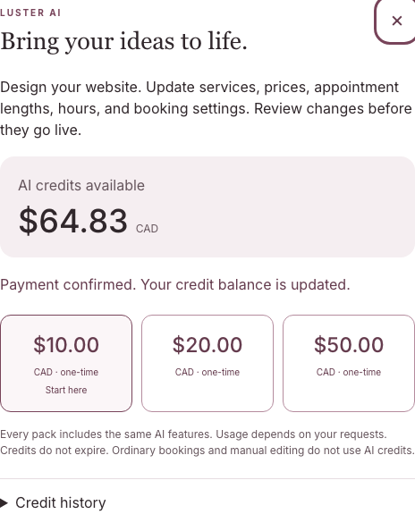
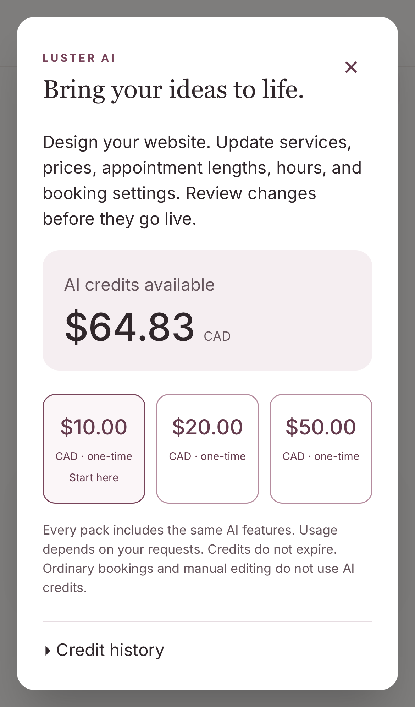

# Development-key rotation and real Stripe sandbox acceptance

October 18, 2026. The owner explicitly approved rotating the Clerk Development secret and entered Stripe sandbox keys through a hidden-input local prompt. No Production credentials, hosted configuration, deployment, migration or live salon data were accessed or changed.

Application checkpoint: `b50f4a4ccc3372101439f980992a04db86b19e79`. The accepted optimized HTTPS archive was built at `c3253898b719219643080abdb713a06a031194d4`; Git comparison confirmed identical application sources, renderer, migrations, public assets, Next configuration and package files. The later checkpoint changes only test/evidence files. This run did not rebuild or substitute application/payment handlers.

## Clerk rotation

The CLI was authenticated. Its instance-specific rotation endpoint was dry-run first, targeting only the previously verified Development instance. The replacement was captured privately, checked against the instance and atomically written to the ignored mode-0600 Development configuration. Its one-time raw capture was removed after acceptance.

- The replacement returned HTTP200 for the expected Development instance.
- Immediate old-key rejection was initially unconfirmed. A subsequent independent check and this task's repeat check both returned HTTP401 for the prior key, with the same Development public identity. [Final proof](rotation-proof.json).
- Fresh real password sign-in through desktop **More → Luster AI** and the iPhone-profile AI introduction reopened the same saved site and survived refresh. Provider responses/native cookies were unmodified, with zero model calls, credential leaks or browser errors. [Desktop](auth-desktop-proof.json), [phone](auth-mobile-proof.json).

Other worktrees' prior private credentials were not rewritten. Their old Development configuration is now stale and must be securely refreshed before future credential-using runs. No replacement value was sent in task messages.

## Real owner-facing purchases and refunds

The signed-in dashboard explicitly identified a Stripe sandbox. Both a read-only account check and Stripe's test-mode balance attested the selected account before any writes. Only three new, metadata-owned AI test products/prices were created: CAD10, CAD20 and CAD50. Existing products/prices were not modified. [Pack setup](pack-setup-proof.json).

The actual committed owner UI opened Stripe-hosted Checkout. Synthetic card payments completed for all three packs, returning to Luster and granting exactly 10,000,000 / 20,000,000 / 50,000,000 micro-CAD. Each purchase has one purchase-ledger entry. These are actual sandbox purchases, not recovery grants or mocked provider responses. [CAD20 journey](checkout-20-proof.json), [CAD50 journey](checkout-50-proof.json), [final database evidence](database-proof.json).

The original CAD10 automation completed its real payment, returned to Luster and passed its balance check, then stopped on an unnecessary attempt to click behind the automatically opened receipt dialog. That failed run/video remains private; it is not reported as an uninterrupted passing browser test. The helper was corrected to recognize the already-open dialog. The CAD20/CAD50 journeys passed, and a separate receipt-recovery check waited for the actual **Payment confirmed** message and enabled controls.

The official Stripe CLI 1.54.0 was downloaded to the private test directory and verified against the SHA256 digest in its official release metadata. No global installation was changed. It forwarded test events only to a loopback bridge and the original `/api/webhooks/stripe-billing` handler. `STRIPE_BILLING_WEBHOOK_SECRET` is separate from the legacy/Connect secrets. Actual provider deliveries produced three processed checkout-completed events, two processed charge-refunded events and one processed checkout-expired event.

- A CAD5 partial refund of the CAD10 purchase reversed exactly CAD5 in credits.
- A full CAD20 refund reversed exactly CAD20 in credits.
- Concurrent duplicate-event replay added no credits. This replay used the captured real event body with a new local test signature; it is not claimed as a Stripe-originated resend.
- Invalid signature: HTTP400 with no credit change. A signed cross-salon mismatch was held; a signed wrong-mode event added no credits. These negative payloads were deliberately local probes, not real Production events.
- Existing services and appointments retained their before/after fingerprints. Six previous model calls remained six; this run made no new AI generation call.

[Refund/security evidence](refund-security-proof.json).

## Mobile and return visits

The iPhone13-profile WebKit run used native taps at 390×844/DPR3. It opened real Stripe Checkout, returned using ordinary browser Back, cancelled through Luster, and verified the provider session was expired/unpaid. No credits were added. The saved site, balance, service/appointment fingerprints and model-call count remained unchanged. Escape restored focus; refresh reopened the credit controls. A real authenticated request for another synthetic salon's credit information returned HTTP403. Browser documents contained zero private Clerk/Stripe/signing-key matches. [Mobile proof](mobile-cancel-proof.json).

This is device emulation, not a physical iPhone test. WebKit reported `maxTouchPoints=0`; the result is retained honestly and native tap actions succeeded.

A fresh return to Stripe's recorded success URL showed **Payment confirmed. Your credit balance is updated.** Reopening and refreshing added no second purchase entry. The final CAD64.825241 ledger balance includes the old recovery/usage balance, the CAD80 total test purchases and CAD25 of test refunds; it is displayed as CAD64.83. [Recovery proof](receipt-recovery-proof.json).

The desktop screenshot is captured directly from the rendered dialog so unrelated uploaded reference artwork remains private. Complete captures, recordings, authenticated fixtures and private temporary harnesses remain outside Git in the task-owned private directories. No API keys, signing secrets, payment/session URLs, raw events or private uploaded artwork are included here.

## Configuration-check correction and local checks

The offline Development checker still looked for the legacy `STRIPE_WEBHOOK_SECRET`. A regression reproduced that it rejected a correctly configured AI-credit billing secret and accepted a legacy-only signing configuration. It now checks `STRIPE_BILLING_WEBHOOK_SECRET`, matching the actual AI-credit endpoint. Credential values remain absent from its report, and its `paymentAcceptanceVerified` field intentionally stays false: a shape check does not claim real checkout evidence.

The bounded focused run passed **87 tests** across the checker, AI-credit configuration, checkout/wallet integration and credit-menu UI. Eight PostgreSQL concurrency cases were skipped by their opt-in guard in this command; they are not counted as passed or relabelled as new PostgreSQL evidence. The first runner command had conflicting worker limits and executed no tests; the accepted run explicitly used `--minWorkers=1 --maxWorkers=2`. Scoped ESLint, TypeScript without emission and whitespace checks passed. A separate copy of the 16 changed files passed the unchanged credential scanner with its standard 5-MiB limit: 16 tracked files, zero generated files, zero reviewed commits. This is a scoped source/evidence scan, not a new full build or full-repository scan.

The real local configuration passes both owner/payment credential-shape gates. A read-only budget attestation confirmed the effective persisted local cap remains CAD11.384406, charged/retained CAD9.578990, pending zero and remaining CAD1.805416. Its older CAD40 file setting does not override the smaller persisted allocation. No provider call, budget reset or production key was used by that check.

## Limits and remaining release gates

This verifies local Development authentication and Stripe sandbox card flows. Network allowlists blocked optional Apple Pay and some hCaptcha asset requests; card payments still completed. Apple Pay, a CAPTCHA interaction, 3DS challenges, declined-card recovery and hosted delivery are not claimed as verified by this run. The earlier optimized build and existing deterministic financial/security coverage remain separate evidence.

The private payment runtime initially refused to start because its explicit sign-in URL was missing. The temporary runtime configuration was corrected before the accepted journeys; no application handler or generated design was repaired.

The payment acceptance runtime deliberately blocked OpenAI, messaging, integrations and publication. Only a synthetic model-configuration marker was supplied for the purchase-availability prerequisite; no design generation or paid AI request was tested in this payment run. Earlier genuine model-generation evidence remains unchanged.

All task-owned app, renderer, browser proxy, Stripe forwarding bridge and CLI listener processes were stopped after acceptance. The pre-existing disposable PostgreSQL service was left untouched. There are no pending credit purchases. No real money was charged or refunded; the CAD80 testing budget was not reset, reallocated or increased.

**Release remains blocked.** Hosted credential/upload/job isolation, the current isolated renderer/owner Preview, approved composition with the separately remediated release code, exact combined-candidate CI/review and protected-main release verification remain outstanding. This checkpoint grants no push, merge, deployment or Production-payment permission.
