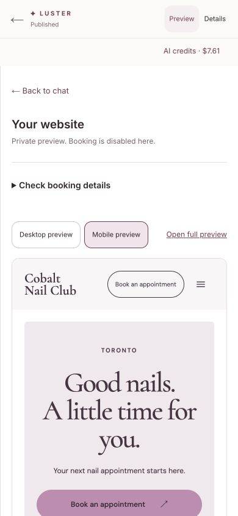

# Owner preview loading and phone usability

Source: `d7bdeaeb150b5ba6433501397c181db87bd43a30`, isolated hosted Preview only. The prior white-reference checkpoint proves actual model generation, exact68 publication and an original signed-out booking; this change does not alter generated source or claim another generation.

A real native Chrome owner walkthrough found an inline preview remaining blank while the full private preview worked. The studio was starting its frame inside a hidden chat panel, and its ResizeObserver could reduce desktop zoom to zero when the panel was hidden. Two deterministic regressions failed before the fix. The renderer now mounts only while the owner opens Preview; the surrounding manual editors remain mounted. Zero-width observations retain the last positive scale. The tests also verify unsaved manual wording survives hiding and reopening the preview.

The same phone walkthrough put titles, design notes and sharing controls above the website. Those are now below the site. Booking facts remain under “Check booking details”; image-quality/rights warnings and exact approval controls remain available. At390CSSpx, the frame's content offset improved from571.1875px to314.59375px, **256.59375px earlier**.

## Verification

- 61 related editor/studio/booking-summary tests pass on the separate audit's qualified Vitest4 config/toolchain and this owned source root; two new regressions were red before implementation. Scoped lint has zero errors/warnings. Secret scanning passes5143 tracked files/three reviewed commits. No package, lockfile or CI changes were made here.
- The pinned hosted build passed explicit TypeScript validation and164/164 static pages. FullSHA/project/Preview metadata, healthd7bdeae and DB/Redis/Clerk matched before switching only the existing test alias. Generic degraded health reflects deliberately unconfigured test integrations.
- A normally signed-in native Chrome owner resumed published68. Chat contained zero renderer iframes. Opening Preview rendered the genuine generated heading immediately; closing removed the frame, reopening rendered again and preserved the chosen phone view. Refresh resumed the same published draft; at390px, phone preview was chosen automatically and the inner351px frame had no overflow.
- The earlier inline failure, full-private-preview success and invalid capture attempts remain privately retained. The final phone screenshot below is an actual loaded owner view, not a source repair or mock.
- Read-only database checks still found one finalized exact68 publication, the canonical three unchanged services, all seven earlier appointment fingerprints and the eighth confirmed50CAD/60min booking with10minute buffer. Call count remained39: this UI verification used no provider call and did not change the design, service settings or appointment history.

The aa99 CI run had15 passing AI-credit cases but three team journeys still tried to click inside the newly collapsed disclosure. The browser test now opens it first; staff data, persistence, review and appointment-impact assertions remain. That old run was superseded/cancelled with one lane running and is not called green. New CI39227058288 is pending. Full combined release and fresh-owner gates remain separate.

No Production deployment, migration, live salon edit, notification or payment occurred. The stable isolated test link servesd7; the renderer deployment and its opaque sandbox, API bindings and approval boundaries are unchanged.

