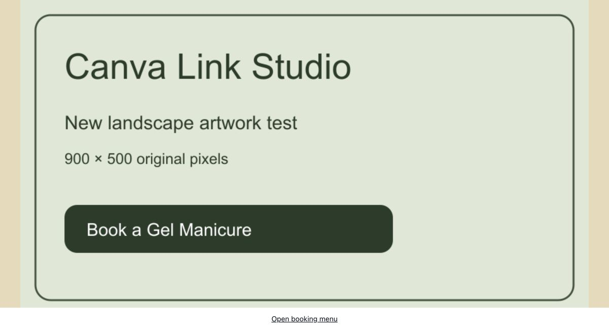
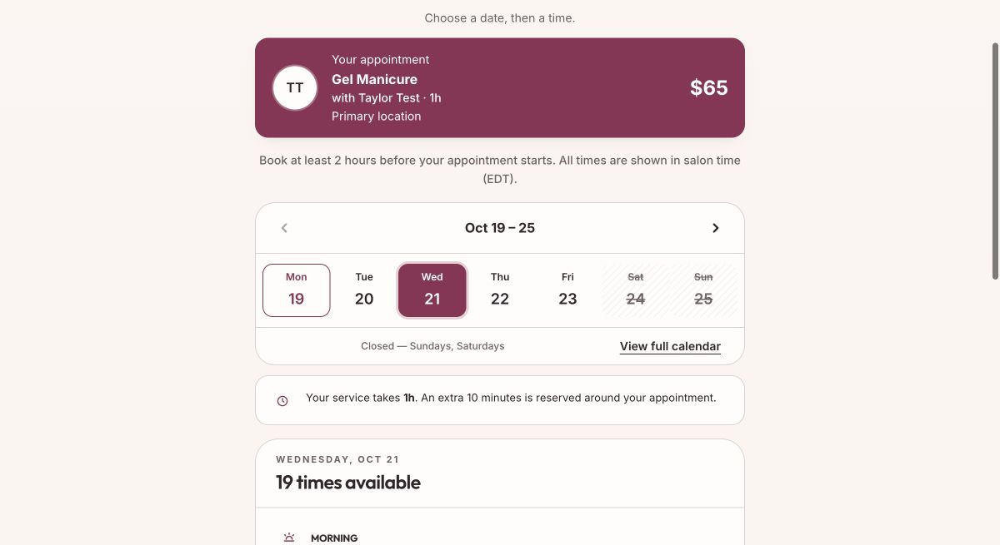

# Native photo Preview qualification — still incomplete

Source: `0e65facb9d4d222f5cd97044852f28014f9220c0`. The [local upload/recovery checkpoint](../native-photo-uploads/README.md) passed 223 backend tests and 41 UI tests. This continuation verifies hosted boundaries; it does **not** qualify native-photo owner acceptance or the complete AI builder.

## Observed state

| Boundary | Evidence |
| --- | --- |
| Isolated database | Read-only TLS connection verified the expected Preview host and `luster_environment=preview` |
| App candidate | `dpl_Dq1e5gdrxQtmNd71YikUsvPgzsJM`, exact source/branch/project, Preview target, READY; not assigned to the public test alias |
| Protected app runtime | Authenticated health returned source `0e65fac`, working DB/Redis/Clerk and ready schema; unknown native photo request returned empty 404 with private/no-store and Vary Cookie |
| Renderer candidate | `dpl_F8x1J2QXjiNutnbi6TfD98vfVS5y`, exact source/branch/project, Preview target, READY |
| Renderer HTTP | Unique URL GET/HEAD 200, native capability, matching boot/CSP hash, exact test parent, opaque sandbox, blocked network and no response cookie |
| Renderer credentials | Preview metadata lists the configured parent origin and no application/provider credential keys; no secret values were decrypted |
| Shared-link browser check | Initial Chrome load stalled during candidate qualification. Cause remains unproven. Native enrollment was not enabled |
| Recovery | Shared renderer alias restored to previous deployment; HTTP bytes matched its immutable source, the example loaded after Reload website, and its image booking button opened the original Luster flow |
| Booking regression | CAD 65 / 60-minute Gel Manicure, Taylor Test, two-hour notice, ten-minute buffer; October 21 returned 19 times, with the existing appointment's overlapping times excluded |
| Data/provider isolation | Other 18 businesses and existing appointment digests preserved; 170 provider calls unchanged; no new appointment or paid model trial |

The app health endpoint remains 503/degraded. Password auth is not configured and optional integrations are off in this isolated test; its schema, DB, Redis and Development auth checks pass. This is not a Production-health acceptance claim.

## Deployment and diagnostic details

The first renderer Git deployment used the wrong source root and returned 404. It was removed. The replacement explicitly builds only `tools/custom-site-renderer` with no application packages and passed its unique-URL HTTP/CSP checks. The application candidate is behind Vercel protection; its login redirect was distinguished from an application failure. Authenticated requests used existing Vercel CLI access without disabling protection. CLI 64.5.0 forwards `--cwd` incorrectly for this curl path; using the process working directory resolved the request. No CLI upgrade was needed.

A shared-alias HEAD 404 during the switch and an initial Chrome frame stall did not establish a code cause. The safe response was rollback, followed by byte-level and browser recovery checks. The renderer **already retries readiness every 250 ms**; an early one-message-race explanation was incorrect. No speculative handshake change was applied.

Current public test state remains:

- App alias: source `57446ad2605534947496cda670a9d5be6c063003`, deployment `dpl_5htScVe2h4RxG2iX3YT8xA1V936w`.
- Renderer alias: source `39014e51cd3dabdcc4a5aa06f4a2a81255b6caba`, deployment `dpl_278chy5XL2KJLYzMJvSYakbSHdPS`.
- Native-photo enrollment is absent/off in Preview configuration. No flag or credential value was changed.

## Remaining acceptance

Qualify the reader in an actual owner browser, then stage the compatible app/reader and enable new photo enrollment narrowly in Preview. Complete upload → visible draft → edit/reload/resume → exact review → isolated publication → original booking, including desktop/mobile and appropriately sized real/synthetic image evidence. The screenshots below show recovery of the **existing manual fixture**, not acceptance of new uploads or an AI-generated design.

Native-photo chat edits, preserved-Canva photo support without a manual import, remaining real-provider/fidelity coverage and final combined release gates also remain incomplete. PR #461 stays draft/NO-GO. No main merge, Production deployment/migration/data change, purchase, credit grant, credential rotation or new provider call occurred here.

