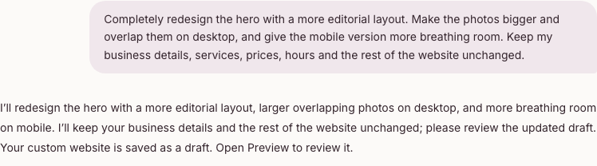
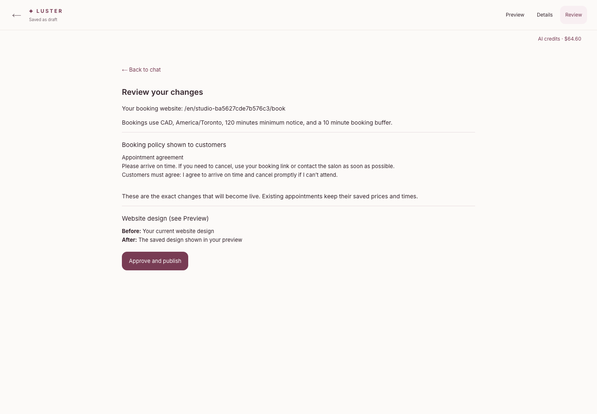
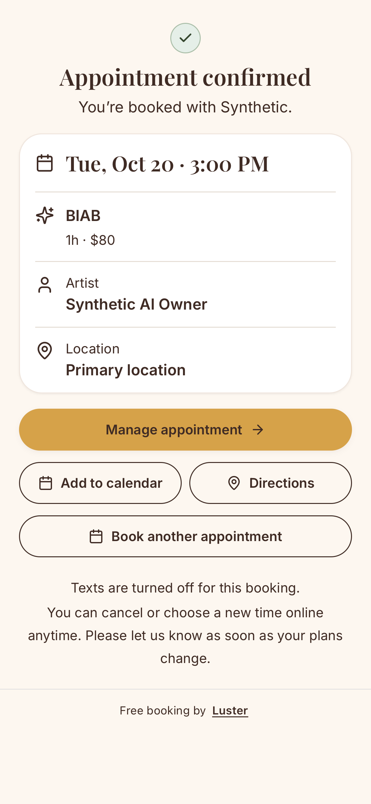

# Stripe-funded owner chat → generated design → original booking

October 18, 2026. This checkpoint closes the local gap between the [real Stripe sandbox purchases](../development-rotation-stripe-checkpoint/README.md) and a real AI request. Application source remains identical to `c3253898` / `9181d2cf`; this checkpoint changes only the acceptance report and evidence. The optimized HTTPS application and credential-free renderer ran on separate local origins against the attested disposable Development database. Nothing was pushed, deployed, migrated remotely or changed in Production.

## What actually ran

The same genuinely authenticated Development owner returned to their saved Lumen Studio website, selected **Make more changes**, and sent this through the ordinary owner chat:

> Completely redesign the hero with a more editorial layout. Make the photos bigger and overlap them on desktop, and give the mobile version more breathing room. Keep my business details, services, prices, hours and the rest of the website unchanged.

The application called OpenAI, validated the resulting custom frontend and saved revision **18** from **17**. It did not select a preset. The request cleared from the composer, displayed progress and recovered after a normal refresh during generation. Both provider responses and source revisions remain privately retained; their hashes, exact identities, usage and lineage are in [generation-proof.json](generation-proof.json). No developer authored or repaired the generated HTML/CSS. The first generated frontend passed validation; no paid repair or second generation was needed.

| Actual provider call | Input tokens | Output tokens | Provider time | Token-based USD estimate |
| --- | ---: | ---: | ---: | ---: |
| OpenAI `gpt-6-luna` conversation | 5,771 | 192 | 3.375s | $0.000818 |
| OpenAI `gpt-6.1-sol` custom frontend | 7,091 | 6,028 | 84.923s | $0.078006 |

The real credit reservation settled after **91.370 seconds**. Exactly **CAD0.220708** was debited from the owner's wallet, which moved from CAD64.825241 to CAD64.604533. The provider estimate totals **USD0.078824**, approximately **CAD0.110354** at the pinned 1.4 conversion. These are usage-ledger estimates, not an independently reconciled OpenAI invoice. The conservative operator expense ledger charged CAD0.157648 and now retains CAD9.736638 against the unchanged CAD11.384406 local allocation, with zero pending and CAD1.647768 remaining. The separate hosted allocation and combined CAD80 ceiling were not changed.

This wallet contains three independently verified Stripe sandbox purchase entries **and historical synthetic recovery credit**. It is mixed funding; this run is not represented as a brand-new account funded solely by Stripe. No new payment or grant occurred here. The acceptance reporter now reads actual tenant-scoped ledger evidence rather than incorrectly retaining its original “unfunded” fixture label after purchases.

## Design and booking evidence

These are captures of the production renderer inside its authenticated private preview. They show the visible hero, not a full-page reference-fidelity benchmark. Desktop uses an editorial split with overlapping illustration panels; mobile stacks the composition and keeps readable spacing. Both checked viewports had no horizontal overflow. The existing service menu, business details, opening hours and policies were retained. The old published frontend still matched the previous publication before approval; only the shared draft projection changed.

**Visual limitation:** this salon had one inspiration reference and no owner photographs. The model made overlapping original floral illustrations, not enlarged salon photos. The chat's preliminary reply still promised “photos”; it should distinguish available images from missing ones more clearly. This run does not prove reference-perfect photo reproduction, new uploads, every layout, or flawless visual quality. The actual service booking target was approximately 86×35 pixels and was tapped successfully; a taller target would improve mobile ergonomics.

The owner opened **Review**, inspected the exact website-only change and selected **Approve and publish**. The approval and sole publication receipt both name revision **18**; live source equals that approved draft. Services, artists and all existing appointment rows remained unchanged. Refresh recovered the published result without another model call. [Publication proof](publication-proof.json).

An anonymous customer then opened the new custom frontend in the iPhone13 WebKit profile and tapped its actual bound BIAB service. Luster's original service selection, calendar, availability, confirmation form and appointment API created exactly one new synthetic appointment: **CAD80, 60 minutes, Synthetic AI Owner**. All four historical appointments retained their original row fingerprints, including earlier CAD65/CAD70 prices. A deliberate virtual-preview-service probe returned HTTP400 `INVALID_SELECTION` and created no appointment. The two observed appointment POSTs include that rejected probe; they are not two successful bookings. [Original booking proof](original-booking-proof.json).

WebKit used native taps at 390×844 and DPR3. It reported `maxTouchPoints=0`; this is device emulation, not a physical iPhone test. Browser errors were empty. Publication, saved-site verification and booking made no additional model calls. Messaging and other outbound integrations stayed disabled/blocked; the confirmation says texts are off.

## Failed automation attempts retained honestly

The first helper stopped before submitting because it looked for a nonexistent Conversation button; returning through the existing Preview toggle corrected the helper. The paid request then completed successfully, but the helper incorrectly fingerprinted the whole salon row, including the legitimate saved-draft projection. The nonbillable recovery verified the actual published fields, historical rows and saved result instead. One recovery assertion also used a timestamp window that excluded the reservation created just before the turn row; correlation by the actual operation identity corrected it. Those failed captures and private diagnostics remain retained outside Git. None caused a second paid request, source repair, new grant or repeat publication.

The scoped script syntax, ESLint and whitespace checks passed. The real WebKit booking exercised the updated funding report. A separate copy of the 12 changed source/evidence files passed the unchanged credential scanner at its standard limits (12 tracked, zero generated, zero reviewed commits); literal matching against the private configured keys also found zero matches. This is a scoped scan, not full-repository verification. The prior checkpoint's 87 passed / 8 skipped focused tests remain separate evidence; no new full build or combined-candidate CI is claimed here.

## Hosted release remains held

A fresh **read-only**, TLS-verified inspection of the dedicated Preview database found the four AI-credit tables absent, plus missing metering and staff/add-on publication columns. [Schema evidence](preview-schema-proof.json). The Preview marker and existing budget were verified; no additional Vercel secrets were decrypted and no migration ran. Aggregate record counts do not establish customer provenance.

Branch-scoped Preview configuration awaits the owner's separate approval. Hosted schema updates, current renderer compatibility, hosted auth/upload/job isolation, composition with the separate release candidate, required combined CI/review and the protected-main release path remain outstanding. Local success does not remove the push/deploy/Production hold or establish hosted payment readiness.

Only curated synthetic screenshots and bounded reports are included here. Original uploads, provider text, credentials, cookies, full private captures, payment URLs and recordings remain outside Git. Task-owned servers were stopped after acceptance; the existing disposable PostgreSQL service was left untouched. The private configuration has no purchase-enable flag, so purchases remain disabled by the application's default. No persistent enablement was made.
