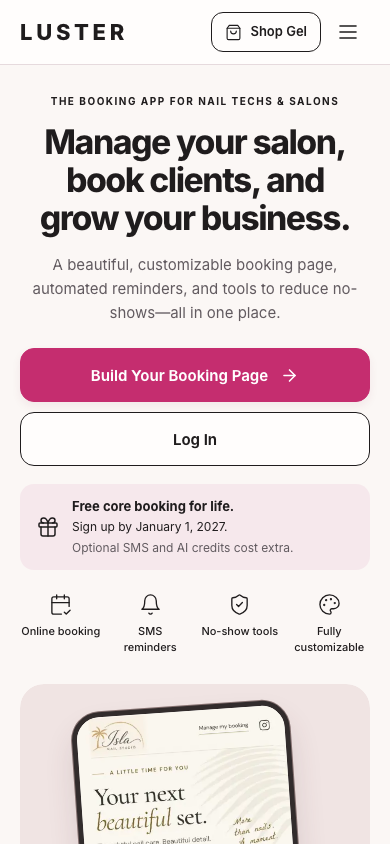
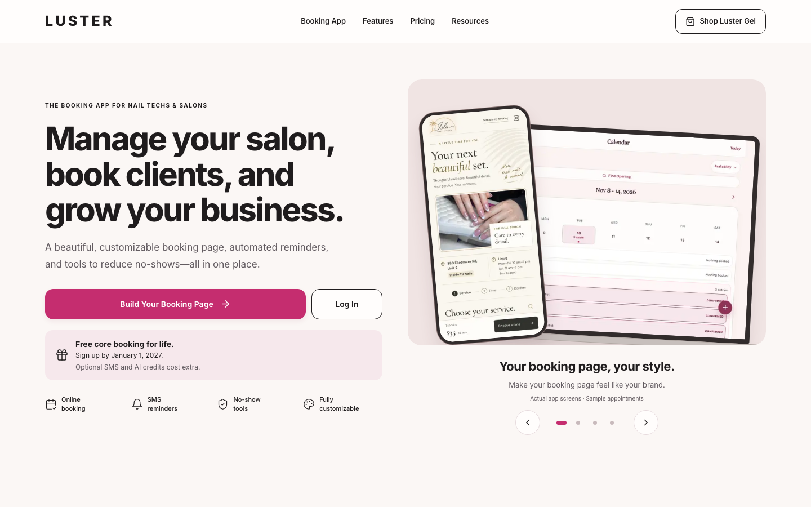

# Luster homepage redesign review

Public-homepage-only first pass, based on `origin/main` at `7df39415`.
This branch is for design review and must not be merged or promoted as part of
this task.

[Full mobile hero including the carousel](mobile-hero.png)

## Changes

- Warm ivory/blush surfaces, existing Inter font and public LUSTER wordmark.
- Compact shop header with keyboard-accessible mobile navigation.
- Separate build and login hero actions; existing destinations and onboarding
  feature flag retained. Disabled onboarding retains the original invite fallback.
- Four real product-preview slides with touch swiping, previous/next controls,
  indicators, keyboard arrows/Home/End, reduced-motion handling and no autoplay.
- Existing feature explanations, pricing, resources, legal links, EN/FR metadata,
  structured data, tenant redirects, authentication and analytics are retained.
- Next Image optimization and lazy screenshots; initial phone image prioritized.

## Promotion and assets

The enforced promotion in `src/libs/billing/foundingLifetime.ts` ends at
`2027-01-02T05:00:00Z`, including January 1 in Toronto. The banner uses that
canonical deadline, not the requested January 31. It expires both on fresh
renders and in an already-open tab. SMS/AI credits remain optional extras.
No billing or eligibility rule was changed.

Product screenshots use the current app and synthetic fixtures; the Isla logo
and nail photography are existing approved assets. The reference's invented
pink Isla interface is not reproduced. All screenshot sources and regeneration
steps are in `public/assets/images/homepage/README.md`. No private customer
records or live appointment data are included.

## Local verification

- Type check: `npm run check-types` under Node 24 with approved CI placeholders.
- Scoped ESLint and 17 Vitest tests covering homepage routes, localization,
  promotion expiry, and SEO.
- Chromium and WebKit at 360, 390, 430, 768, 1024 and 1440 pixels: no overflow;
  links, menu, carousel buttons, indicators and stable sizing checked.
- Touch swipe exercised through Chromium CDP; WebKit covers buttons and layout.
- Full Next.js app exercised separately from the isolated Vite fixture.
- Axe WCAG A/AA scan: zero violations after the scroll-region focus fix.
- French mobile smoke check at 360px: correct localized build link, no overflow.
- Screenshots above captured from the full Next app with only the dev indicator
  hidden. No runtime page errors during capture.

The browser image-loading assertion intentionally excludes the desktop-only
laptop on mobile; a hidden lazy image is not required to download.
