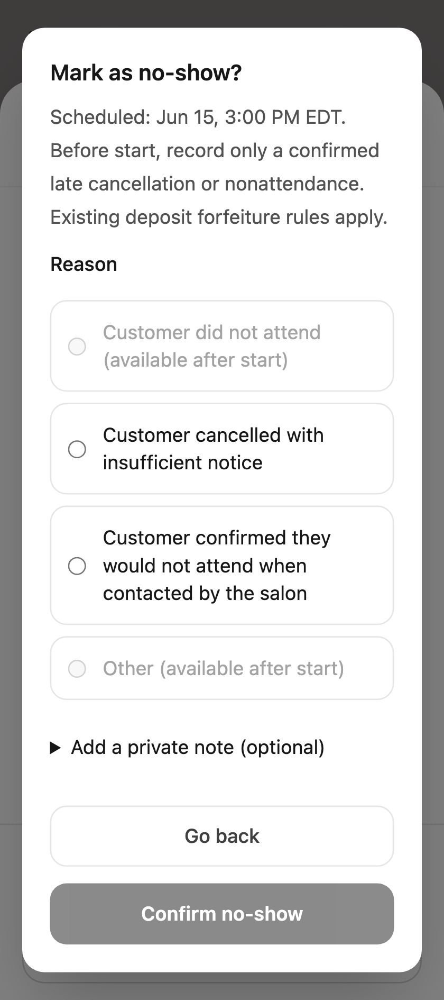
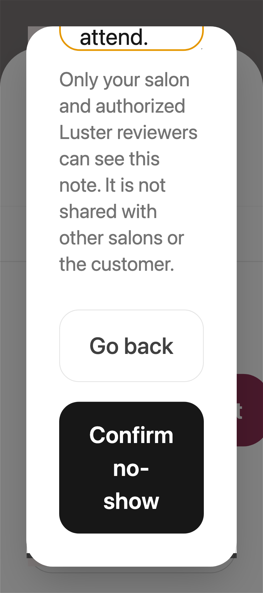

# No-show reporting: implementation and verification

Base: origin/main at 482551428a59a4b192e98a1919ba949a520213ef. Branch: codex/no-show-reporting.

## Result

An owner can mark a 3pm Toronto appointment at 2:30pm with **Customer confirmed they would not attend when contacted by the salon**. The source status, selected reason, timestamp and private note are committed atomically, and an eligible receiving-salon risk read immediately returns count 1. Source cancellation remains separate.

The action opens at exactly 24 elapsed hours before canonical start; it has no arbitrary deadline afterward. Before start, only explicit late cancellation or confirmed nonattendance is accepted. At/after start, attendance absence and Other are available; Other requires an explanation. Existing appointment-state restrictions remain.

The existing network, HMAC/exact-pair identity, prospective public-booking binding, 12-calendar-month expiry, tenant scopes, suppression/erasure, platform gates and deposit policy infrastructure are reused. No database schema changes or new dependencies.

## UI and operations

- Appointment → Mark no-show → select reason → confirm → explicit shared/local-only acknowledgement. Optional private notes are behind a disclosure. Required controls work at 320px and enlarged text.
- The warning says **Recorded No-Show History**, explains the eligible aggregate count/window, and does not predict behavior or blacklist anyone.
- A customer uses a valid private booking link to request review of that appointment. The request suspends its contribution immediately, including when publication was pending. The response reveals no source identifier, other salon, identity match, network count, or private appointment information.
- Platform reviewers use the existing no-show ledger's Customer review requests filter. Review decisions require a reason and current appointment version. Upholding cannot override another suppression, source correction/deletion, identity invalidation, expiry or platform pause.
- Owners/platform staff can correct an erroneous source record. Active and review-suspended events become revoked; durable appointment audit evidence prevents resurrection even after shorter network-audit cleanup.
- Existing paid deposits, holds and financial snapshots are reviewed manually through current payment tools. No automated refund or charge is introduced. The runbook defines the earlier-deposit review procedure.

## Final local test results

| Verification | Result |
| --- | --- |
| Selected Vitest unit/integration suite | 254 passed across 26 files |
| Disposable PostgreSQL serialization suite | 8 passed; zero skipped |
| Appointment workflow browser fixtures | 12 passed: desktop Chromium, iPhone WebKit, 320px Chromium and WebKit |
| Owner no-show records browser fixtures | 4 passed: mobile/desktop Chromium, including French and 200% text |
| Tightened prestart dialog proof after visual inspection | 4 passed; control bounds and viewport visibility checked |
| Next route generation and TypeScript | Passed using approved CI provider placeholders |
| Changed/new TypeScript/TSX lint | Passed |
| Secret hygiene and diff whitespace | Passed |

The 4 tightened prestart checks repeat cases included in the 12 workflow checks; they are not counted twice. Total distinct executed tests: 278. No real messages, bookings, charges or production records were used.

### Coverage mapping

| Requirement | Evidence |
| --- | --- |
| >24h, exactly24h, 30min, start, after, no deadline | noShowReporting.test.ts; cancel/noShow.integration.test.ts |
| Confirmed nonattendance, late cancellation, Other | Policy, dialog and owner-route integration tests |
| Normal cancellation and manual/walk-in exclusion | Owner-route integration; existing network tests |
| Immediate cross-salon propagation and minimal data | Owner-route integration; networkNoShow.integration.test.ts |
| Duplicate/concurrent publication and review | Owner-route integration plus real PostgreSQL serialization |
| Correction, disputes, suppression and replay fences | Correction API integration; network tests; private review tests |
| Exact identity, tenant isolation, HMAC, erasure | Existing network suites plus owner-route integration |
| Timezones/DST | Canonical offset boundary tests; configured Toronto UI display |
| Deposit thresholds/readiness and expiry | Existing deposit/risk suites and calendar-anniversary tests |
| Invalid/expired/revoked capabilities, operator-only resolution | Private review integration and restricted review API tests |
| Mobile/accessibility | Chromium/WebKit fixture tests with enlarged text and clipped-control bounds |

## Visual evidence

All clients and appointment data below are synthetic. The first image shows the compact default flow; optional notes can be expanded. The second shows the confirmation control after scrolling at 200% text, with no horizontal clipping.

## Verification limits and release boundary

- Full provider/live-production E2E and production deployment were not performed. Preview/CI status belongs to the pull request and is separate from these local results.
- New no-show writes require a structured reason; older clients that omit it receive a validation error. Existing past no-show history remains compatible. Legacy future marks without confirmation evidence wait until start before new publication.
- Public dispute intake requires a valid capability for the reported appointment. Existing manage-link expiry remains; an expired/unavailable link needs verified support or an authorized salon manager to issue a fresh link. Find my booking targets active appointments and is not guaranteed to recover a no-show. Closed review requests are not silently reopened or falsely acknowledged as suspended.
- Platform staff must process the new review queue and the documented earlier-deposit review. Automatic deposit-review notifications/refunds were not added.
- Rate limiting reuses the existing per-process limiter; it is not a new distributed abuse-control service.
- Source writes, local status, audit and network publication are atomic; another salon sees the result on its next authorized fresh risk read. No new cross-salon push service was added.

## Files changed

- `docs/runbooks/network-no-show-protection.md`
- `docs/runbooks/no-show-reporting-and-review.md`
- `docs/runbooks/no-show-reporting-assets/mobile-large-text-confirm.png`
- `docs/runbooks/no-show-reporting-assets/mobile-reason-dialog.png`
- `docs/runbooks/no-show-reporting-verification.md`
- `src/app/[locale]/[slug]/manage/[token]/ManageAppointmentActions.tsx`
- `src/app/api/admin/network-no-show/correct/route.integration.test.ts`
- `src/app/api/admin/network-no-show/correct/route.ts`
- `src/app/api/admin/network-no-show/records/route.ts`
- `src/app/api/appointments/[id]/cancel/noShow.integration.test.ts`
- `src/app/api/appointments/[id]/cancel/route.test.ts`
- `src/app/api/appointments/[id]/cancel/route.ts`
- `src/app/api/appointments/[id]/route.ts`
- `src/app/api/appointments/[id]/transition/route.test.ts`
- `src/app/api/appointments/[id]/transition/route.ts`
- `src/app/api/public/appointments/manage/[token]/no-show-review/route.ts`
- `src/app/api/super-admin/network-no-show/correct/route.ts`
- `src/app/api/super-admin/network-no-show/records/route.ts`
- `src/app/api/super-admin/network-no-show/review/route.test.ts`
- `src/app/api/super-admin/network-no-show/review/route.ts`
- `src/components/admin/BookingRiskCard.test.tsx`
- `src/components/admin/BookingRiskCard.tsx`
- `src/components/admin/NoShowRecordsModal.tsx`
- `src/components/appointments/AppointmentQuickEditSheet.test.tsx`
- `src/components/appointments/AppointmentQuickEditSheet.tsx`
- `src/components/appointments/NoShowReportDialog.test.tsx`
- `src/components/appointments/NoShowReportDialog.tsx`
- `src/components/appointments/NoShowReviewRequest.test.tsx`
- `src/components/appointments/NoShowReviewRequest.tsx`
- `src/components/super-admin/NoShowRecords.tsx`
- `src/components/ui/confirm-dialog.tsx`
- `src/hooks/useAppointmentActions.test.tsx`
- `src/hooks/useAppointmentActions.ts`
- `src/libs/appointmentManage.ts`
- `src/libs/networkNoShow.concurrency.integration.test.ts`
- `src/libs/networkNoShow.integration.test.ts`
- `src/libs/networkNoShow.server.ts`
- `src/libs/networkNoShowReview.server.ts`
- `src/libs/noShowReporting.server.ts`
- `src/libs/noShowReporting.test.ts`
- `src/libs/noShowReporting.ts`
- `src/locales/en.json`
- `src/locales/fr.json`
- `tests/browser/appointmentWorkflow/appointment-workflow.spec.ts`
- `tests/browser/appointmentWorkflow/main.tsx`
- `tests/browser/appointmentWorkflow/playwright.config.ts`

## Current-main release validation — 2026-10-15

The release candidate incorporates main at `b419c8b1b54d93406b705769994f4c9d5fc00d3f` without conflicts. Fresh local checks passed: 178 focused tests across 20 files, 8 disposable loopback PostgreSQL serialization tests with zero skips, 28 appointment workflow browser checks and 6 owner records browser checks. The prestart reason/confirmation/shared acknowledgement passed on desktop Chromium, iPhone WebKit and 320px Chromium/WebKit. Next route generation, TypeScript, changed-file lint, tracked-tree secret scanning and whitespace checks passed. No production appointment or payment was changed by validation.

Release review also found that the staff appointments page did not pass the shared no-show handler. The page now exposes the same reason dialog. A staff-page regression reproduced the missing action before the fix and then passed through confirmed nonattendance to the visible shared acknowledgement afterward. The focused staff/hook/dialog/sheet rerun passed all 63 checks.

The current-main CI owner-browser job reached its 55-minute limit during the final geometry check after a slow dependency installation. CI now distributes the same owner checks across onboarding-owner and owner-operations groups, alongside customer-booking. A parsed-YAML comparison confirms that every original step and command remains, conditional test coverage is unchanged, and the required aggregate gate, environment and timeout remain unchanged. Each new group is required by the existing aggregate. The additional local owner-form run passed 52 browser checks.
